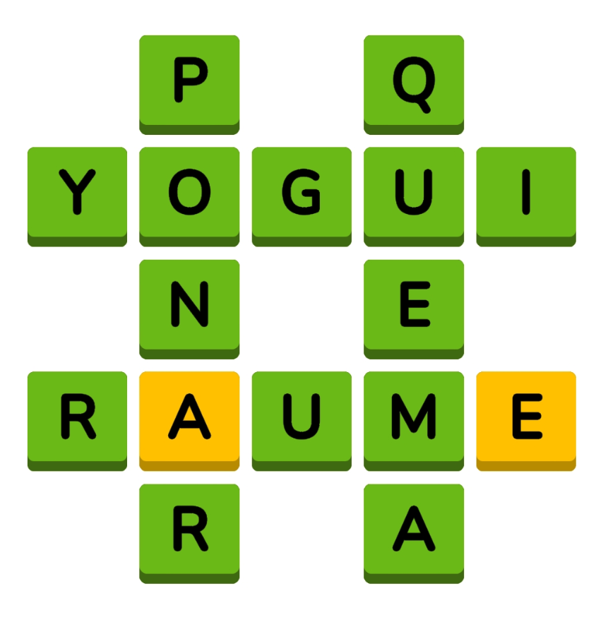

# Single-player puzzles

Ideas for the separate single-player bot decided in
[ADR 0011](../adr/0011-separate-bot-for-single-player-games.md). **None is built or scheduled.**
These are not duels, so they don't implement `GameEngine` (see [README.md](README.md)).
Rules below are the intended shape, not a final spec.

## Shared shape

- **Daily puzzle.** Every player gets the same puzzle each day, generated from a date seed, plus
  an optional unlimited practice mode.
- **Unique solution.** A generator must produce puzzles with exactly one solution (except word
  games). This is the main engineering cost of grid puzzles.
- **Server authority.** The server holds the puzzle and checks the submitted solution; the client
  never decides that a puzzle is solved. For word games the answer stays on the server and the
  client gets only per-guess feedback.
- **Time.** The server records the start time and the solve time, so rankings can't be forged
  from the client. Rankings and streaks are per bot, not shared with `games`.
- **Pure checkers.** A puzzle's rules (`isValid`, `isSolved`, generator) are pure functions in
  a package of their own, with no React or Supabase, like game engines.
- **Mini App by default.** Drag, paint and keyboard input need it. Only word games with a short
  keyboard could live in chat.
- **Names.** Most of these are other companies' products or trademarks; use original names
  (see below).

## Catalogue

| Puzzle          | Mechanic                                      | Input           | Generator difficulty | Entry cost |
| --------------- | --------------------------------------------- | --------------- | -------------------- | ---------- |
| Queens-style    | One queen per row, column and colour region   | Tap cells       | Medium               | Medium     |
| Zip-style       | One path through numbered cells in order      | Drag            | Medium               | Medium     |
| Flow Free-style | Join same-colour dots without crossing        | Drag            | Medium to high       | Medium     |
| Wordle-style    | Guess a hidden word with per-letter feedback  | Keyboard        | Low                  | Low        |
| Hangman         | Guess a hidden word letter by letter          | Keyboard        | Low                  | Low        |
| Word Hashtag    | Swap tiles to form four crossing words        | Tap two tiles   | Medium (word lists)  | Low        |
| Sudoku          | Fill 9×9 with no repeats per row, column, box | Tap and numbers | Medium               | Medium     |
| Patches-style   | Split a grid into rectangles from clue cells  | Drag            | Medium to high       | Medium     |

## Puzzles

### Queens-style

- **Rules:** N×N grid split into N coloured regions. Place N queens so each row, column and
  region has exactly one, and no two queens touch, diagonals included.
- **Generator:** build a valid placement, grow regions around it, then check uniqueness with a
  solver. A solver is also the basis for hints.
- **Notes:** "Queens" is LinkedIn's name for it. The underlying puzzle is a regions variant of
  N-queens. Use an original name.

### Zip-style

- **Rules:** a grid with numbered cells and, in some versions, walls. Draw one path that visits
  every cell and goes through the numbers in order.
- **Generator:** generate a Hamiltonian path first, then place numbers along it and add walls
  until the solution is unique.
- **Notes:** "Zip" is LinkedIn's name. Dragging along a path needs care on touch screens.

### Flow Free-style

- **Rules:** coloured pairs of dots; join each pair with a path, paths can't cross and every
  cell must be filled (the usual rule).
- **Generator:** harder than it looks to keep solutions unique and puzzles pleasant. Existing
  level packs are an alternative to a generator.
- **Notes:** "Flow Free" is a commercial game; use an original name and original levels.
- **Contrast:** two-player "race the same board" fits here better than in most puzzles.

### Wordle-style

- **Rules:** guess a five-letter word in six tries. Each guess shows letters in the right
  place, present elsewhere or absent.
- **Generator:** none; it needs a curated answer list and a larger list of accepted guesses,
  **per language**. This ties in with the i18n decision in `CLAUDE.md` (Telegram's
  `language_code`): Spanish needs its own lists, accents and plurals handled.
- **Notes:** "Wordle" is a trademark of The New York Times. The server must keep the answer
  secret and send only feedback. Lowest-cost puzzle and a good first one.

### Hangman

- **Rules:** guess a hidden word by letters with a limited number of wrong guesses.
- **Notes:** generic name, no trademark issue. Can work in chat with a letter keyboard. It also
  has a two-player form (one player picks the word), which would need hidden state and is close
  to a duel.

### Word Hashtag



- **Rules (read from the example above, to be confirmed):** 16 letter tiles laid out in a `#`
  shape on a 5×5 grid. Two words run across (rows 2 and 4) and two run down (columns 2 and 4),
  each five letters long. They cross at four shared tiles. The tiles start scrambled; the player
  swaps tiles until all four words are valid.
- **Feedback:** a tile in its right place is **green**. A tile whose letter belongs in the
  solution but not there is **yellow** (in the example, `A` and `E`). Swapping those two fixes
  the puzzle.
- **Example solution:** across `YOGUI` and `REUMA`, down `PONER` and `QUEMA`.

  ```text
  . P . Q .        . P . Q .
  Y O G U I        Y O G U I
  . N . E .   →    . N . E .      (swap the yellow A and E)
  R A U M E        R E U M A
  . R . A .        . R . A .
  ```

- **Generator:** pick four words so the crossings match: across word 1 and down word 1 share
  letter 2, across 1 and down 2 share letter 4, and likewise for across 2 (row 4). Scramble the
  solved grid with a chosen number of swaps, so the puzzle is known to be solvable in that many.
  The minimum number of swaps is the tile count minus the number of permutation cycles.
- **Several valid solutions:** more than one set of dictionary words can fit the same tiles, and
  the colours depend on one chosen solution. Decide whether the checker accepts any valid set of
  words or only the intended one. Accepting any set is friendlier but means the feedback must be
  computed against the intended solution while the win check uses the dictionary.
- **Server authority:** the intended solution and the word list stay on the server; each swap
  returns the new colours.
- **Language:** needs a curated Spanish word list (this example is Spanish) with five-letter
  words and a rule for accents and `ñ`. English needs its own list. This is the same cost as
  Wordle-style (see above).
- **Notes:** "Word Hashtag" is the name you gave, which may belong to an existing game; check
  before using it. The swap-to-fix-words format resembles an existing family of daily word
  games, so use an original name and original puzzles.
- **Open questions:** a limit on swaps (and what happens when it runs out), whether green tiles
  are locked, what counts as a score (swaps left, time), and a hint that reveals one tile.

### Sudoku

- **Rules:** standard 9×9 with digits 1 to 9 once per row, column and 3×3 box.
- **Generator:** generate a full grid, remove cells while keeping the solution unique, and grade
  difficulty by the techniques a solver needs. A well-known, easy-to-find problem.
- **Notes:** generic name. Smaller variants (4×4, 6×6) are good for beginners and for phones.

### Patches-style

- **Rules:** a grid with clue cells (a number and sometimes a shape). Split the grid into
  rectangles so each contains exactly one clue and matches it.
- **Generator:** partition the grid into rectangles, place clues, then check uniqueness.
- **Notes:** "Patches" is LinkedIn's name. The mechanic is the Shikaku family of puzzles.

## Suggested order, if built

1. **Wordle-style**, **Hangman** and **Word Hashtag**: no grid solver needed (Word Hashtag only searches word lists), so they validate the bot, the daily
   puzzle, streaks and the server-held secret cheaply. Language lists are the real cost.
2. **Sudoku**: one well-understood generator and solver to prove the grid pipeline.
3. **Queens-style**, **Zip-style**, **Patches-style** and **Flow Free-style**: each needs its
   own generator and solver.

## Open questions

- Original names for each puzzle (see the naming notes above).
- Languages: English first, Spanish soon after? Word lists need curation per language.
- Rankings: by time, by number of moves or hints, or only a streak.
- Anti-cheat level: how far to go with server-measured time for a casual bot.
- Whether to add a social race mode, which would change
  [ADR 0011](../adr/0011-separate-bot-for-single-player-games.md).
